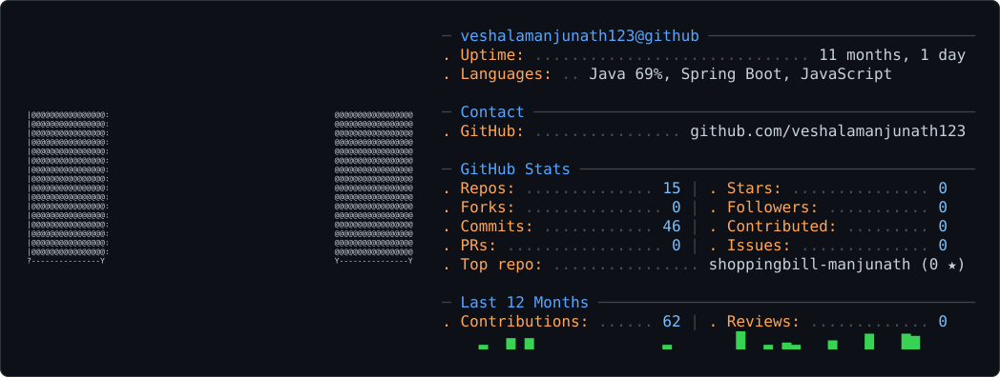

<!-- GH-ASCII CARD HEADER -->
<div align="center">
  <picture>
    <source media="(prefers-color-scheme: dark)" srcset="dark_mode.svg" />
    <source media="(prefers-color-scheme: light)" srcset="light_mode.svg" />
    
  </picture>
</div>

<br/>

<!-- DYNAMIC TYPING BANNER -->
<div align="center">
  <h1>Hey there, I'm <a href="https://github.com/veshalamanjunath123">Manjunath Veshala</a> 👋</h1>
  <a href="https://git.io/typing-svg">
    
  </a>
</div>

<p align="center">
  <a href="mailto:manjunath.veshala@gmail.com">
    
  </a>
  <a href="https://leetcode.com/manjunath_veshala" target="_blank">
    
  </a>
  <a href="https://github.com/veshalamanjunath123?tab=repositories">
    
  </a>
</p>

---

### 👨‍💻 About Me

```yaml
name: Manjunath Veshala
role: Frontend & Full-Stack Developer
location: India 🇮🇳
learning: Advanced Web Frameworks & Cloud Architecture
focus: Building high-performance, accessible web applications
reach_me: manjunath.veshala@gmail.com
```

- 💡 **Currently Learning:** Next-gen frontend frameworks & modern architectures.
- 💬 **Ask Me About:** React, Spring Boot, Java, and RESTful API design.
- 🎯 **Goals:** Contributing to open-source software and solving challenging algorithmic problems.

---

### 🛠️ Tech Stack & Skills

<div align="center">

#### 🌐 Languages & Frontend
<a href="https://skillicons.dev">
  
</a>

<br/>

#### ⚙️ Backend, Frameworks & Core
<a href="https://skillicons.dev">
  
</a>

<br/>

#### 🗄️ Databases & Cloud
<a href="https://skillicons.dev">
  
</a>

<br/>

#### 🧰 Developer Tools
<a href="https://skillicons.dev">
  
</a>

</div>

---

### 📊 GitHub & Problem Solving Analytics

<div align="center">
  <!-- GitHub Overall Stats -->
  
  &nbsp;
  <!-- Top Languages -->
  
</div>

<br/>

<div align="center">
  <!-- LeetCode Problem Solving Stats -->
  
</div>

<br/>

<!-- GitHub Profile Trophies -->
<div align="center">
  <a href="https://github.com/ryo-ma/github-profile-trophy">
    
  </a>
</div>

---

<p align="center">
  
</p>
